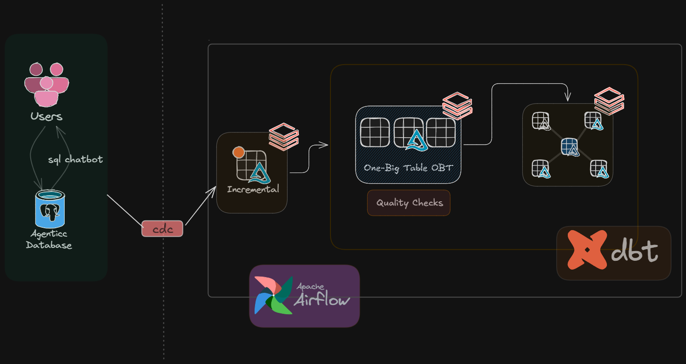

# 🛒 Retail Analytics Lakehouse Pipeline

An end-to-end data engineering pipeline designed to handle live transactional retail data, capturing complex omnichannel fulfillment and supply chain workflows. Built on Databricks and orchestrated by Apache Airflow, this pipeline extracts data from a serverless PostgreSQL database via Change Data Capture (CDC) and processes it through a Medallion architecture using dbt for scalable transformations, automated quality assurance, and a Star Schema Gold layer.

## 📐 Architecture



| Layer | Storage/Tool | Purpose |
| :--- | :--- | :--- |
| **Source** | Neon PostgreSQL | Serverless Agentic Database handling live SQL chatbot transactions |
| **Ingestion** | CDC | Captures row-level inserts/updates/deletes with minimal source impact |
| **Bronze / OBT** | Databricks / Delta Lake | One-Big-Table (OBT) incremental landing zone with raw historical data |
| **Silver / Prep** | dbt (Ephemeral models) | Cleansed, deduplicated, and normalized data models; automated quality checks |
| **Gold / Serving** | Databricks / dbt | Star Schema — business-ready aggregations, KPIs, and SCD Type 2 history |

## 🛠 Tech Stack

| Category | Tools |
| :--- | :--- |
| **Source Database** | Neon PostgreSQL (Serverless) |
| **Data Lakehouse** | Databricks, Delta Lake |
| **Transformation & Modeling** | dbt (Data Build Tool), Ephemeral Models |
| **Orchestration** | Apache Airflow |
| **Ingestion Pattern** | Change Data Capture (CDC) |
| **Data Modeling** | Star Schema, SCD Type 2, Medallion Architecture |
| **Languages** | SQL, Python, Jinja2 |

## 📁 Project Structure

```text
retail-lakehouse/
│
├── dags/                        # Apache Airflow DAGs
│   ├── retail_cdc_ingestion.py  # CDC extraction and landing DAG
│   └── dbt_transformation.py    # dbt run & test orchestration
│
├── dbt_retail/                  # dbt project directory
│   ├── models/
│   │   ├── staging/             # Ephemeral staging models (Silver)
│   │   ├── intermediate/        # Join & normalization logic
│   │   └── marts/               # Star schema fact & dim tables (Gold)
│   ├── snapshots/               # SCD Type 2 snapshot configurations
│   ├── tests/                   # Custom data quality tests
│   └── dbt_project.yml          # dbt configuration
│
├── scripts/
│   └── setup_neon_cdc.sql       # Postgres replication slot setups
│
├── docs/
│   └── retail-architecture.png  # Architecture diagram
└── README.md
```

## 🔄 Pipeline Flow

### 1. Ingestion — Source to Bronze
* **Agentic Source:** Users interact with a retail system via an SQL chatbot, generating live transactional data stored in a serverless Neon PostgreSQL database.
* **CDC Extraction:** A Change Data Capture (CDC) mechanism reads the PostgreSQL Write-Ahead Log (WAL), extracting incremental data (inserts, updates, deletes) without putting analytical load on the transactional database.
* **Landing:** Data lands incrementally into the initial Delta Lake layer on Databricks, forming a consolidated One-Big-Table (OBT) structure for raw storage.

### 2. Transformation — OBT to Silver (dbt)
* **Ephemeral Models:** dbt is used to build ephemeral models that cleanse and standardize the raw OBT data. These models do not materialize as physical tables, saving storage and compute costs.
* **Data Quality Gates:** Automated dbt tests (`not_null`, `unique`, `accepted_values`) enforce strict schema validation and data integrity before downstream processing.

### 3. Serving — Gold Layer (Star Schema & SCD Type 2)
* **Dimensional Modeling:** Data is structured into a highly optimized Star Schema (e.g., `fact_sales`, `dim_customer`, `dim_product`) for downstream BI consumption.
* **dbt Snapshots (SCD Type 2):** Changes in dimensions (like customer addresses or product prices) are tracked using dbt snapshots, preserving exact historical records with `dbt_valid_from` and `dbt_valid_to` timestamps.

## ⚙️ Apache Airflow Orchestration

Airflow acts as the control plane for the entire pipeline. The DAGs are designed to:
1. **Trigger:** Run on a scheduled cadence (or via event triggers) to fetch the latest CDC batches.
2. **Execute Ingestion:** Push the incremental data to the Databricks Delta Lake OBT.
3. **Execute dbt:** Trigger `dbt run` for transformations and `dbt test` for quality gates.
4. **Dependency Management:** If a data quality test fails at the OBT/Silver layer, Airflow halts the pipeline, preventing bad data from contaminating the Gold Star Schema.

## 📊 SCD Type 2 — Slowly Changing Dimensions

To accurately track changing retail metrics (e.g., a product changing categories, or a user updating their shipping address), dbt snapshots are utilized:

| Column | Description |
| :--- | :--- |
| `dbt_scd_id` | System-generated unique key per version |
| `product_id` | Original source natural key |
| `price` | The value being tracked for changes |
| `dbt_valid_from` | Timestamp when this version became active |
| `dbt_valid_to` | Timestamp when this version was superseded (null if current) |

## 🛡 Data Quality

Data quality is treated as code. Enforced natively via dbt at the OBT/Silver layer:
* **Primary Key Integrity:** `unique` and `not_null` tests on all transaction IDs.
* **Referential Integrity:** `relationships` tests ensuring every `customer_id` in a fact table exists in the `dim_customer` table.
* **Business Logic:** Custom SQL tests to ensure order quantities and prices are strictly positive values.

## 🔑 Key Engineering Decisions

* **Why CDC over Batch Polling?**
  Polling queries (`SELECT * WHERE updated_at > X`) put heavy read loads on the production database. CDC reads the transaction log, providing near real-time updates with near-zero performance impact on the Neon Postgres source.
* **Why dbt Ephemeral Models?**
  Instead of materializing intermediate tables and paying for unnecessary Databricks storage/compute, ephemeral models compile as Common Table Expressions (CTEs) in the final run, streamlining the architecture.
* **Why Airflow over Native Schedulers?**
  Airflow provides Pythonic, code-based dependency management. It allows the pipeline to strictly couple ingestion success with transformation execution, and halt the entire DAG if a `dbt test` fails.
* **Why Neon PostgreSQL?**
  Neon separates storage and compute, allowing the database to scale to zero when the SQL chatbot is idle, making it a highly cost-effective and modern agentic database solution.

## 📦 Prerequisites

* Databricks Workspace (Premium tier for advanced Delta features)
* Apache Airflow environment (Local, MWAA, or Astronomer)
* dbt Core installed with `dbt-databricks` adapter
* Neon PostgreSQL account and connection string
* Python 3.9+

## 🏃 Getting Started

```bash
# Clone the repository
git clone https://github.com/your-username/retail-lakehouse.git
cd retail-lakehouse

# Setup Python virtual environment
python -m venv venv
source venv/bin/activate

# Install dependencies (Airflow & dbt)
pip install -r requirements.txt

# Configure dbt profile
cp profiles.yml ~/.dbt/profiles.yml
# Update ~/.dbt/profiles.yml with your Databricks host and HTTP path

# Run dbt tests locally
cd dbt_retail
dbt test

# Execute the dbt pipeline
dbt run
```

## 🧑‍💻 Author

**Shrutam Macwan** — Data Engineer | Master of Data Analytics
📍 Niagara Falls / Niagara Falls, Ontario, Canada
🔗 [LinkedIn](https://linkedin.com/in/shrutam-macwan31) · [GitHub](https://github.com/Shrutam31)

